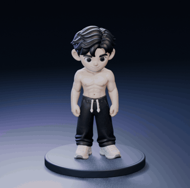

# photo-to-3d｜照片转 3D 模型

**简体中文** · [English](README.en.md)

[](https://github.com/zgx949/photo-to-3d/actions/workflows/ci.yml)
[](https://github.com/zgx949/photo-to-3d/releases)
[](LICENSE)

把单张人物照片做成卡通角色的 3D 模型，可导出用于切片的 STL、带颜色的 GLB 和浏览器预览。项目同时提供 [Agent Skill](SKILL.md) 和 Python CLI。

**原始照片 → 卡通参考图 → 用户确认 → Seed3D 建模 → 本地网格修复、上色和预览**

Skill 引导 Agent 检查照片、保留人物辨识特征和原始姿势，并在提交付费任务前展示参考图供确认。CLI 从已准备好的参考图开始，也能复用已有模型完成本地后处理。

## 3D 模型展示

| 手办 | Q 版西装男生 |
| :---: | :---: |
|  |  |

两段 360° 转台预览均由项目输出的彩色 OBJ 渲染，保留原始模型的顶点色。

## 安装 Agent Skill

从 [GitHub Releases](https://github.com/zgx949/photo-to-3d/releases) 下载 `photo-to-3d.zip`，将解压出的整个 `photo-to-3d/` 放入 Agent 的技能目录。也可以克隆源码，把克隆出的目录放到相同位置。

| Agent | 用户级目录 | 项目级目录 |
| --- | --- | --- |
| Codex | `~/.agents/skills/photo-to-3d/` | `.agents/skills/photo-to-3d/` |
| Claude Code | `~/.claude/skills/photo-to-3d/` | `.claude/skills/photo-to-3d/` |

将 `SKILL.md` 和随附的 `scripts/`、`assets/`、`references/` 保留在同一个技能目录下。其他兼容的 Agent 请按各自的技能加载方式安装。[Codex 技能文档](https://developers.openai.com/codex/skills) · [Claude Code 技能文档](https://code.claude.com/docs/en/skills)

在 Agent 的脚本环境中安装下方的 Python 依赖。方舟任务的创建与查询需要 Key，已有模型的本地后处理可直接运行。附上照片后，可以说「把这张全身照做成 Q 版手办，先给我看参考图，确认后再输出 STL 和彩色 GLB」。参考图制作需要宿主提供图像编辑能力，或由你提供准备好的参考图。人物分割可以使用宿主工具完成。

## CLI 快速开始

### 1. 获取源码并配置环境

从源码运行时，在仓库根目录执行。使用 Release 安装时，进入解压后的 `photo-to-3d/` 再执行后续命令。

```bash
git clone https://github.com/zgx949/photo-to-3d.git
cd photo-to-3d
```

核心 CLI `scripts/ark_3d.py` 支持 Python 3.9 起，仅使用标准库。运行包含实体修复的完整流水线，建议选 Python 3.11 或 3.12，并确认平台有 Open3D 的预编译包。[Open3D 安装文档](https://www.open3d.org/docs/0.19.0/getting_started.html)

```bash
python3.12 -m venv .venv
source .venv/bin/activate
python -m pip install -r requirements.txt -r requirements-solidify.txt
```

| 用途 | 需要安装 |
| --- | --- |
| 建模任务创建、查询、下载和凭据检查 | Python 标准库 |
| 尺度与网格检查、上色 | `requirements.txt` |
| 封闭实体重建与减面 | `requirements.txt` 和 `requirements-solidify.txt` |
| 可选预览截图 | `python -m pip install playwright`，然后执行 `python -m playwright install chromium` |

### 2. 配置方舟 API Key

在方舟控制台创建 API Key，并在模型详情页开通 Seed3D 2.0。生成任务按方舟规则计费，参考图的处理费用取决于你使用的图像服务。[API Key 管理](https://console.volcengine.com/ark/region:cn-beijing/apikey) · [Seed3D 2.0](https://console.volcengine.com/ark/region:cn-beijing/model/detail?name=doubao-seed3d-2-0) · [方舟 3D API](https://docs.volcengine.com/docs/ark/create-3d-generation-task-api)

通过运行环境或宿主的密钥管理设置 `ARK_API_KEY`。也可将 Key 保存为技能目录下的单行 `.ark_key`，在 Unix 上设置 `chmod 600 .ark_key`。核心 CLI 的读取优先级是全局参数 `--key`、环境变量 `ARK_API_KEY`、`.ark_key`。请将 Key 保存在本机或密钥管理器中。

```bash
printf '输入方舟 API Key: '
IFS= read -r -s ARK_API_KEY
printf '\n'
export ARK_API_KEY
python scripts/ark_3d.py doctor
```

`doctor` 调用任务列表接口检查凭据，无需创建生成任务。`401` 时检查 Key，`403` 时检查账号和模型授权。

### 3. 用确认过的参考图生成模型

选用单主体、轮廓清晰的全身参考图。CLI 接受本地图片、公网图片 URL 或 `data:` URI，参考图会发送给方舟处理。建议使用 PNG 或 JPEG，图像边长 300–6000 px，宽高比 0.4–2.5，单张小于 30 MB。[完整图片约束与生成参数](references/ark-3d-api.md)

```bash
# 查看请求体，无需 Key，也不会提交任务
python scripts/ark_3d.py create --image ./cartoon-ref.png --dry-run

# 提交生成任务，然后修复网格、上色并生成预览
python scripts/pipeline.py --image ./cartoon-ref.png --out ./out --name model
```

默认向 Seed3D 请求 `obj`、`high`，在本地按 150 mm 高度修复，目标面数约 60 万。`--level medium` 调低方舟输出精度，`--no-refine` 使用约 25 万面的本地快档。脚本以 JSON 输出汇总，日志写入 stderr。查看 `files` 获取实际生成的路径，查看 `printable`、`watertight` 和 `warnings` 判断网格状态。

| 产物 | 默认目录 | 用途 |
| --- | --- | --- |
| 原始 OBJ、MTL 和贴图 | `out/3d/` | 保留原始材质，或留作后处理输入 |
| 修复后的 OBJ、STL | `out/print/` | STL 已转为 Z-up 并落地，可导入切片软件检查 |
| 带顶点色的 OBJ、GLB | `out/color/` | GLB 适合 Blender、浏览器和其他 3D 工具 |
| HTML 查看器和可选 PNG | `out/preview/` | HTML 内嵌模型，浏览器需联网加载 three.js |

上色需要原始模型带有贴图。顶点色的切片支持因软件而异。打印前请在切片软件中检查支撑、薄壁和实际尺寸。

## 常用命令

```bash
# 只生成并下载原始 GLB，使用标准库即可
python scripts/ark_3d.py run --image ./cartoon-ref.png --format glb --out ./out

# 查询既有任务
python scripts/ark_3d.py status --task-id "TASK_ID"

# 复用带贴图的 OBJ 或 GLB，本地重跑后处理
python scripts/pipeline.py --skip-3d ./mesh_textured_pbr.obj --out ./out --height 120

# 缺少实体修复依赖时，用现有模型检查尺度并导出网格
python scripts/pipeline.py --skip-3d ./mesh_textured_pbr.obj --out ./out --no-solidify --no-color
```

核心 CLI 可用 `create`、`status`、`download` 分步处理异步任务，或用 `run` 一次完成。下载结果中，`path` 是原始产物，`model_path` 是可导入的模型路径。请在临时链接失效前下载，并将 OBJ 与配套 MTL、贴图一起保存。

```bash
python scripts/ark_3d.py --help
python scripts/pipeline.py --help
```

## 文档与贡献

- [Skill 执行说明](SKILL.md) · [人物特征与参考图模板](references/identity-prompt.md) · [提示词示例](examples/prompts.md)
- [常见问题](docs/faq.md) · [链路设计](docs/architecture.md) · [方舟 API 参考](references/ark-3d-api.md)
- [贡献与发布流程](CONTRIBUTING.md) · [更新记录](CHANGELOG.md)

在源码目录安装轻量和开发依赖后，可以本地验证并打包。CI 的检查无需方舟 API Key。

```bash
python -m pip install -r requirements.txt -r requirements-dev.txt
make test
make lint
make package
```

`make package` 生成 `dist/photo-to-3d.zip` 和 `dist/photo-to-3d.zip.sha256`。推送与项目和 CLI 版本一致的 `vX.Y.Z` 标签后，GitHub Actions 在检查通过时将两份文件附到 GitHub Release。[版本发布步骤](CONTRIBUTING.md#发布新版本)

## 许可

项目按 [MIT 许可证](LICENSE) 开源，由社区维护。方舟模型与服务适用火山引擎的服务条款。
