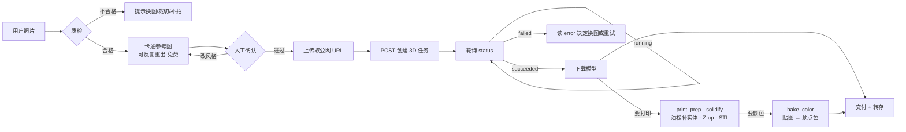

# 设计说明

## 链路



## 三个关键取舍

### 1. 为什么要"先卡通化"而不是照片直出

Seed3D 这类图生 3D 模型本质上做的是**单主体的几何+材质重建**。实拍照片里的皮肤毛孔、布纹、复杂光影、背景杂物，都会变成噪声：要么被抹平成塑料，要么被误判为结构。

卡通参考图的作用不是"好看"，而是**降维**：

- 去掉高频纹理 → 几何拓扑可读
- 纯色背景 → 主体边界唯一
- 四肢分离 → 避免 A-pose 粘连成一坨
- 服饰大色块 → PBR 材质能对上

所以 `SKILL.md` 里的提示词模板是围绕"可建模性"写的，而不是围绕审美写的。

### 2. 为什么确认闸门是硬性的

3D 生成按次计费、耗时数分钟到十几分钟，且**失败也可能计费**。如果 Agent 自动跑完参考图直接建模，参考图一旦不像本人（真人转卡通最常见的失败），用户就要为废图付钱。

因此把"免费且可迭代"的步骤（参考图）放在前面，把"付费且慢"的步骤（3D）放在人工确认之后。这条闸门在 `SKILL.md` 里写成了禁止性规则，不随上下文软化。

### 3. 为什么先上传再建模，而不是本地 Base64

方舟支持 `data:image/...;base64,...`，但请求体上限 64 MB、单图上限 30 MB，且大 Base64 会显著拖慢提交并更容易触发超时。上传换 URL 后请求体只有几十字节，稳定性高得多。Base64 保留为本地快速验证的备选路径（`normalize_image` 中实现，含大小与格式校验）。

## 任务状态机

```
create ──> queued ──> running ──> succeeded ──> file_url（24h 有效）
                            └──> failed ──> error.code / error.message
```

- `queued` 表示已受理、等待并发位（Seed3D 2.0 上限 5 并发）
- `failed` 分两类：输入问题（换图）与服务端问题（有限重试一次）
- 任务记录 7 天可查，但产物链接 24 小时失效——`run` 一次性完成下载就是为了避开这个时间窗

## 错误分级策略

| 现象 | 判定 | 动作 |
|---|---|---|
| 401 | Key 无效/格式错 | 不重试，回引导用户重新拿 Key |
| 403 | Key 有效但模型未开通 | 不重试，引导去控制台开通 |
| 429 | 限流 | 指数退避，最多 3 次 |
| `failed` + 输入类 error | 图不合格 | 修图/换图后重建 |
| `failed` + 服务类 error | 平台侧 | 最多自动重试 1 次并告知用户 |

## 可扩展点

- **新模型**：`--model` 传 Model ID 即可；差异记录在 `references/ark-3d-api.md`
- **新产物格式**：在 `MODEL_EXTS` 加后缀，并补一条 `guess_ext` 单测
- **批处理**：`create` 与 `status` 已解耦，外部可自行编排并发与队列
- **预览**：`make_preview.py` 把彩色 glb 内联进 `assets/viewer.template.html`，生成单文件 three.js 查看器（双击即开，可旋转 / 缩放 / 线框 / 下载）；产物同样可直接丢进 Blender / Unity 等外部场景。查看器只在浏览器端从 jsDelivr 取 three.js，Python 侧不引入前端构建依赖
